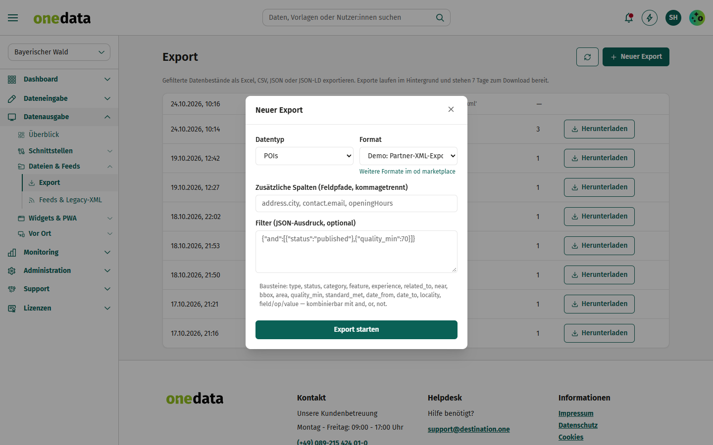

# Demo: Partner-XML-Export

Vorlage für Partner, die ihr **Exportformat** im od marketplace anbieten möchten.

## Anbieter

**destination.one GmbH** – Hersteller von one.data, dem Redaktionssystem für Tourismusdestinationen.

- Web: [www.destination.one](https://www.destination.one)
- Kontakt: [info@destination.one](mailto:info@destination.one)

## Kurzbeschreibung

Gibt Points of Interest, Gastronomie und weitere Datentypen als eigenes XML-Format aus – als Datei unter
*Datenausgabe → Dateien & Feeds → Export* und als dauerhafter Feed.

## Beschreibung

Exportformate werden **deklarativ** über eine [Scriban](https://github.com/scriban/scriban)-Vorlage beschrieben.
one.data erledigt Abfrage, Filter, Freigaben, Lizenzen und Datenschutz – die Vorlage bekommt nur bereits
gefilterte und aufgelöste Datensätze.

### Modell in der Vorlage

| Variable | Inhalt |
|---|---|
| `items` | Liste der Datensätze: `id`, `type`, `name`, `status`, `updated_at`, `data` (Datendokument) |
| `meta` | `generated_at`, `count`, `format`, `extension`, `extension_version` |
| `config` | Einstellungen der Instanz laut `config_schema` (hier `lang`, `include_teaser`) |
| `od.text(wert, "de-DE")` | Text einer Sprache aus Sprachfeldern `[{lang, text}]` |
| `od.xml(text)` | XML-Escaping |

Sicherheitsgrenzen: keine Includes, begrenzte Schleifen/Rekursion/Ausgabegröße.

### So funktioniert es

1. Extension im od marketplace **aktivieren** und unter *Einstellungen* die Sprache wählen.
2. *Datenausgabe → Dateien & Feeds → Export*: Format „Demo: Partner-XML-Export“ wählen, Datentyp und Filter setzen,
   Export starten und herunterladen.
3. Oder unter *Feeds* einen dauerhaften Endpunkt mit diesem Format anlegen (`/v1/feeds/{slug}`).

Beispielausgabe: `samples/export.xml`.
